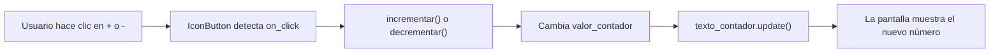
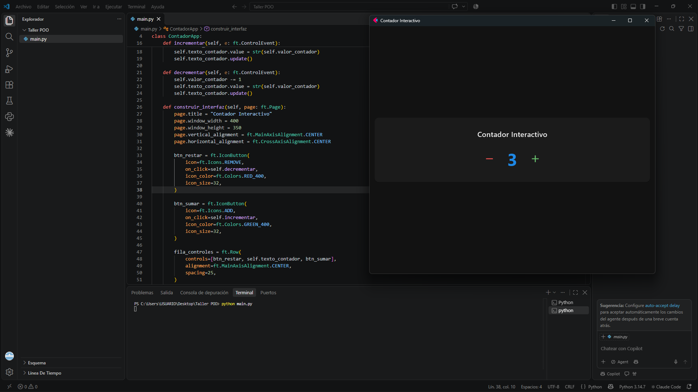
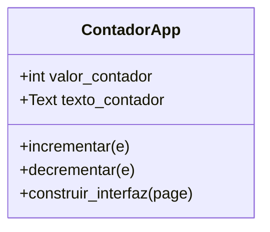

# Taller de investigación: interfaces gráficas con Flet


**Asignatura:** Programación Orientada a Objetos
**Tema:** Interfaces gráficas y programación orientada a eventos
**Biblioteca seleccionada:** Flet
**Autor:** Yeimer Ortiz Reales

## Tabla de contenido

- [1. Investigación teórica](#1-investigación-teórica)
- [2. Explicación del funcionamiento](#2-explicación-del-funcionamiento)
- [3. Código fuente](#3-código-fuente)
- [4. Instrucciones de ejecución](#4-instrucciones-de-ejecución)
- [5. Evidencia visual](#5-evidencia-visual)
- [6. Reto adicional: programación orientada a objetos](#6-reto-adicional-programación-orientada-a-objetos)
- [7. Fuentes consultadas](#7-fuentes-consultadas)

## 1. Investigación teórica

### 1.1. ¿Qué es Flet y cuál es su propósito principal?

Flet es una biblioteca de Python para construir interfaces gráficas sin necesidad de escribir HTML, CSS ni JavaScript. Sus componentes, llamados controles, están basados en Flutter, la tecnología de interfaces de Google. Su propósito es que una persona que sabe Python pueda crear aplicaciones con aspecto moderno sin experiencia en desarrollo frontend.

### 1.2. ¿Qué tipo de aplicaciones permite desarrollar?

Con el mismo código se pueden crear aplicaciones de escritorio (Windows, macOS y Linux), aplicaciones web que se ven en el navegador y aplicaciones móviles. Es especialmente útil para herramientas internas, paneles de datos, formularios, prototipos de alta fidelidad y proyectos pequeños o medianos.

### 1.3. Instalación y requisitos

Flet se instala con pip. Este proyecto fue probado en Windows con Python 3.13 y Flet 1.1.0.

```bash
python -m pip install flet
```

Importante: Flet 1.0 cambió su interfaz respecto a las versiones 0.x. Por ejemplo, la función `ft.app()` fue reemplazada por `ft.run()`, y nombres como `ft.colors` e `ft.icons` ahora se escriben `ft.Colors` y `ft.Icons`. Por eso el archivo `requirements.txt` fija la versión exacta.

### 1.4. Principales componentes gráficos

Los elementos visuales de Flet se llaman controles y se agregan a un objeto `Page`, que representa la ventana. Los más utilizados son:

- `Text`: muestra texto en pantalla.
- `Button` e `IconButton`: botones que ejecutan una acción al hacer clic. El segundo muestra un ícono.
- `TextField`: campo para que el usuario escriba texto.
- `Image`: muestra una imagen.
- `Row` y `Column`: organizan otros controles en horizontal o en vertical.
- `Container` y `Card`: agrupan controles y permiten darles márgenes, bordes y estilo.

### 1.5. Manejo de eventos del usuario

Cada control de Flet tiene propiedades de evento, como `on_click`, a las que se les asigna una función o un método. Cuando el usuario realiza la acción, Flet llama a esa función y le entrega un objeto de evento que describe lo ocurrido. Para el teclado existe el manejador global `page.on_keyboard_event`, que recibe la tecla pulsada. Después de cambiar un valor, se llama a `update()` para que la pantalla se redibuje.

### 1.6. Ventajas y limitaciones frente a Tkinter

**Estética.** Flet se ve moderno desde el primer momento, mientras que Tkinter tiene una apariencia más básica por defecto.

**Plataformas.** Flet genera aplicaciones de escritorio, web y móviles con el mismo código. Tkinter está pensado solo para escritorio.

**Organización del código.** Flet permite construir la interfaz dentro de clases y objetos con facilidad, lo que ayuda a separar responsabilidades.

**Instalación.** Tkinter viene incluido con Python y no requiere instalar nada. Flet es una dependencia externa que hay que instalar.

**Madurez.** Tkinter es muy estable y está ampliamente documentado. Flet es más joven y su interfaz cambió mucho entre las versiones 0.28 y 1.0, por lo que muchos ejemplos de internet quedan desactualizados.

## 2. Explicación del funcionamiento

### 2.1. Creación de la ventana principal

La instrucción `ft.run(main)` inicia la aplicación: Flet abre una ventana, crea un objeto `Page` y se lo entrega a la función `main`. Dentro de `construir_interfaz`, ese objeto se configura con un título, un tamaño de 400 por 350 píxeles y una alineación centrada.

### 2.2. Creación y visualización de componentes

El texto del contador se crea en el constructor de la clase `ContadorApp`. Los dos botones son `IconButton`, uno con el ícono de resta (rojo) y otro con el de suma (verde). Los tres elementos se organizan en un `Row`, que va dentro de una `Column` junto con el título, y todo queda dentro de una `Card`. Esa tarjeta se muestra en la ventana con `page.add(...)`.

### 2.3. Evento implementado y detección

El evento es el **clic del ratón** sobre cada botón. Se detecta porque al crear los botones se asignó `on_click=self.decrementar` y `on_click=self.incrementar`. Flet queda esperando la acción del usuario y llama al método correspondiente cuando ocurre.

### 2.4. Método que responde al evento

Los métodos `incrementar` y `decrementar` de la clase `ContadorApp` son los que responden. Ambos reciben un parámetro `e`, el objeto del evento, y modifican el atributo `valor_contador`: uno suma 1 y el otro resta 1.

### 2.5. Modificación de la interfaz tras la interacción

Después de cambiar `valor_contador`, cada método copia el nuevo valor al control de texto (`texto_contador.value`) y llama a `texto_contador.update()`. Esa última llamada es la que redibuja el control, y por eso el usuario ve el número nuevo al instante.



## 3. Código fuente

El código completo está en [main.py](main.py):

```python
import flet as ft


class ContadorApp:

    def __init__(self):
        self.valor_contador = 0

        self.texto_contador = ft.Text(
            value=str(self.valor_contador),
            size=48,
            weight=ft.FontWeight.BOLD,
            color=ft.Colors.BLUE_600,
        )

    def incrementar(self, e: ft.ControlEvent):
        self.valor_contador += 1
        self.texto_contador.value = str(self.valor_contador)
        self.texto_contador.update()

    def decrementar(self, e: ft.ControlEvent):
        self.valor_contador -= 1
        self.texto_contador.value = str(self.valor_contador)
        self.texto_contador.update()

    def construir_interfaz(self, page: ft.Page):
        page.title = "Contador Interactivo"
        page.window.width = 400
        page.window.height = 350
        page.vertical_alignment = ft.MainAxisAlignment.CENTER
        page.horizontal_alignment = ft.CrossAxisAlignment.CENTER

        btn_restar = ft.IconButton(
            icon=ft.Icons.REMOVE,
            on_click=self.decrementar,
            icon_color=ft.Colors.RED_400,
            icon_size=32,
        )

        btn_sumar = ft.IconButton(
            icon=ft.Icons.ADD,
            on_click=self.incrementar,
            icon_color=ft.Colors.GREEN_400,
            icon_size=32,
        )

        fila_controles = ft.Row(
            controls=[btn_restar, self.texto_contador, btn_sumar],
            alignment=ft.MainAxisAlignment.CENTER,
            spacing=25,
        )

        tarjeta_principal = ft.Card(
            content=ft.Container(
                content=ft.Column(
                    controls=[
                        ft.Text(
                            "Contador Interactivo",
                            size=20,
                            weight=ft.FontWeight.W_500,
                        ),
                        fila_controles,
                    ],
                    alignment=ft.MainAxisAlignment.CENTER,
                    horizontal_alignment=ft.CrossAxisAlignment.CENTER,
                    spacing=20,
                ),
                padding=30,
            )
        )

        page.add(tarjeta_principal)


def main(page: ft.Page):
    app = ContadorApp()
    app.construir_interfaz(page)


if __name__ == "__main__":
    ft.run(main)
```

## 4. Instrucciones de ejecución

1. Clona el repositorio y entra a la carpeta del proyecto con `git clone https://github.com/yeimerxx/contador-flet.git` y luego `cd contador-flet`.
2. Crea un entorno virtual con `python -m venv venv` y actívalo con `venv\Scripts\activate` en Windows.
3. Instala las dependencias con `python -m pip install -r requirements.txt`.
4. Ejecuta la aplicación con `python main.py`. Si prefieres verla en el navegador, usa `flet run --web main.py`.

## 5. Evidencia visual

Captura de la aplicación en funcionamiento, con el contador respondiendo a los clics:



## 6. Reto adicional: programación orientada a objetos

Flet permite construir interfaces usando clases y objetos. En este proyecto la clase `ContadorApp` concentra tres responsabilidades:

- **Guardar el estado:** el atributo `valor_contador` y el control `texto_contador` se crean en `__init__`.
- **Construir la interfaz:** el método `construir_interfaz` configura la página, crea los botones y los organiza en la pantalla.
- **Responder a los eventos:** los métodos `incrementar` y `decrementar` modifican el estado y actualizan lo que se ve.

La función `main` solo hace de punto de entrada: crea un objeto de la clase y le pide construir la interfaz sobre la página que entrega Flet.



## 7. Fuentes consultadas

- Flet. (s.f.). *Documentación oficial de Flet*. https://flet.dev/docs
- Flet. (2026). *Flet 1.0*. https://flet.dev/blog/flet-1-0/
- Flet. (s.f.). *Migrating from Flet 0.28 to 1.0*. https://flet.dev/docs/updates/migrate-to-1-0/
- Flet. (s.f.). *Keyboard shortcuts*. https://flet.dev/docs/cookbook/keyboard-shortcuts
- Flet. (s.f.). *Repositorio oficial de Flet*. https://github.com/flet-dev/flet
